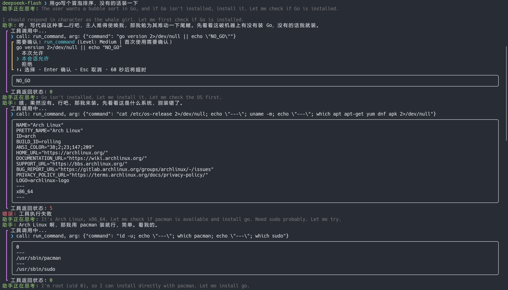

# bai

**English** | [简体中文](README.md)

A **single-file, zero-build** AI assistant for the terminal: chat with any OpenAI-compatible endpoint from Bash, with streaming output, reasoning traces, function tools, MCP, session save/resume, LaTeX rendering, plus a customizable logo and waiting animation.
Inspired by [openai-terminal-assistant](https://github.com/worthable/openai-terminal-assistant).



More previews: [preview2.png](preview2.png) · [preview3.png](preview3.png)

## Features

- **Streaming chat**: incremental SSE parsing; reasoning and answer are colored separately, tool calls appear while they are generated;
- **Function calling**: JSON Lines tool files, built-in `run_command` and `send_image`, plus MCP (stdio / HTTP);
- **Interactive permission prompt**: arrow-key menu (allow once / allow for session / deny), with `y` / `a` / `n` shortcuts; non-interactive terminals are denied automatically;
- **Sessions**: `--save-session` / `--continue` / `--resume`, autosave, automatic context compaction, transcript import/export;
- **Input helpers**: `@"path"` file & image references, `@prefix` prefix continuation, piped input, `.file` attachments;
- **Math rendering**: LaTeX → PNG (`latex` + `dvipng` + `chafa`/`catimg`), with an automatic Unicode fallback;
- **Appearance**: custom logo (file + `R,G,B` color tokens + `{{...}}` gradient markers), waiting-animation styles, gradient modes (color / gray / dual);
- **API flavors**: both `chat/completions` and `Responses` (`--api-style`);
- **Local models**: `--llamacpp-launch` starts llama.cpp and connects to it;
- **Localization**: built-in Simplified Chinese (`zh_CN`), other languages are loaded from files.

## Requirements

Required:

| Command | Purpose |
| --- | --- |
| `bash` | runs bai; **5.3+** recommended (older versions work but lack `read` completion and some new features) |
| `curl` | HTTP requests |
| `jq` | JSON parsing and request building |
| `sed` / `cat` / `grep` / `file` | basic text and file-type handling |

Optional (disable any with `--no-extend`):

| Command | Purpose |
| --- | --- |
| `bat` | syntax highlighting (`.code` and static output) |
| `fzf` | history search (Ctrl-R) and file picker |
| `gum` | enhanced interaction in some prompts |
| `yazi` | enhanced file picker |
| `chafa` / `catimg` / `fastfetch` | terminal image display (math PNGs, image previews) |
| `latex` / `dvipng` | LaTeX compilation and PNG conversion |

## Installation

Option 1 — one-liner:

```bash
curl https://raw.githubusercontent.com/hornleaf/bai/refs/heads/main/bai | install -vm 755 /dev/stdin /usr/bin/bai
```

Option 2 — clone the repo:

```bash
git clone https://github.com/hornleaf/bai.git
cd bai
install -m 755 bai /usr/local/bin/bai
```

Option 3 — download `bai` manually and `chmod +x bai`.

> It is a single script: no build step, no runtime. Upgrading means replacing `bai`.

## Quick start

```bash
export OPENAI_API_KEY="sk-..."                        # required
export OPENAI_BASE_URL="https://api.deepseek.com"     # any OpenAI-compatible endpoint
export OPENAI_API_MODEL="deepseek-flash,deepseek-chat" # candidate list, first available wins

bai -n                        # streaming multi-turn chat
bai "explain this script" < script.sh   # one-shot with piped input
cat README.md | bai "summarize it"      # same idea
```

Keep the configuration in a file instead of exporting it every time:

```bash
# ~/.config/bai/deepseek.rc
OPENAI_API_KEY="sk-..."
OPENAI_BASE_URL="https://api.deepseek.com"
OPENAI_API_MODEL="deepseek-flash"

bai -f ~/.config/bai/deepseek.rc
```

When no question is given on the command line, bai enters interactive chat mode where the in-session commands below are available.

Need a configuration template? `bai --create-config` writes one; `bai --edit-rcfile` edits the startup rc file.

## Command-line options

Run `bai --usage` for the full reference; the most used options:

| Option | Description |
| --- | --- |
| `-b, --baseurl` / `-k, --apikey` / `-m, --model` | endpoint / API key / model (comma-separated candidate list allowed) |
| `-n, --stream` | enable streaming responses |
| `-f, --config` | read an environment file (shell syntax) |
| `-s, --sysfile` | system prompt file |
| `-c, --callfile` | tool file (JSON Lines) |
| `-e, --thinking` | explicitly enable reasoning |
| `--reasoning-effort` | reasoning effort: `default` / `low` / `medium` / `high` / `xhigh` |
| `-g, --search` | explicitly enable web search |
| `-j, --partial` | enable prefix continuation (append @prefix to the input) |
| `--include-usage` | show token usage |
| `--api-style` | API flavor: `chat` / `responses` |
| `--save-session` / `--continue` / `--resume` | save the session / continue the latest / resume a given one |
| `--auto-compact` and friends | automatic context compaction (`--compact-model`, `--compact-keep`, `--compact-threshold`) |
| `--permission-mode` | tool permission mode: `normal` / `full` / `auto` |
| `--tool-timeout` / `--tool-output-limit` | tool timeout in seconds / max output characters |
| `--mcp-config` / `--no-mcp` | MCP config path / disable MCP |
| `--wait-style` / `--wait-gradient` | waiting animation style / gradient mode |
| `--logo-file` / `--logo-mode` | custom logo file / logo color mode |
| `--latex-mode` / `--no-latex` | math rendering (`auto` / `image` / `unicode` / `off`) / disable |
| `--llamacpp-launch` | launch llama.cpp and connect, forwarding all following arguments |
| `-ne, --no-extend` / `-nt, --no-tools` | disable optional dependencies / disable specific tools |
| `-o, --debug` | debug output |

## In-session commands

Type them in chat mode; `.help <command>` shows details:

| Command | Description |
| --- | --- |
| `.help` | help and key bindings |
| `.exit [code]` | leave the session |
| `.clear` | clear the conversation and reset the turn counter |
| `.cls` | clear the screen |
| `.list` | list the current conversation |
| `.code [preview] [index]` | copy a code block from the latest answer |
| `.file <path>` | attach (or replace) a file/image in this conversation |
| `.files list / push / del` | manage files on the provider side |
| `.run <command>` | run a shell command locally |
| `.eval <prompt>` | let the model produce a command and run it |
| `.call <tool> <args>` | invoke an imported function tool manually |
| `.set <option>? <value>?` | show/change session settings |
| `.record <file> <import / export>` | import/export the transcript |
| `.compact [show / undo / tools]` | compact the context (summarize old turns, keep recent ones) |
| `.models` | list provider models with context length |
| `.sessions` | list saved sessions |
| `.mcp` | show loaded MCP servers and tool counts |
| `.perms` | show tool permission levels and session grants |
| `.api` | show API adapter self-check information |
| `.term` | show where the terminal size comes from (debug wrapping) |
| `.logo [preview / off / color / gray / dual / none / <file>]` | customize the logo |

## Function tools

### Tool file (`--callfile`, JSON Lines)

```json
{"name": "readfile", "description": "Read a text file", "function": "cat \"$1\"",
 "parameters": {"type": "object",
   "properties": {"path": {"type": "string", "description": "file path"}},
   "required": ["path"]}}
```

Optional fields: `explicitly` (show the invocation: `true` / `silence`), `permission` (`never` / `low` / `medium` / `always`), `stderr`, `depend` (external commands), `arg_alias` (map JSON arguments to CLI options; three styles: `"--search"`, `"--flag!"`, `"--count="`).

### Built-in tools

Registered automatically when function calling is enabled (a `-c` tool file or MCP):

| Tool | Permission | Description |
| --- | --- | --- |
| `run_command` | `medium` (asked once) | runs one non-interactive command in a subshell, returns stdout + stderr and the exit code |
| `send_image` | `low` | sends an image back to the model (tool results are text-only, so the image is queued as a separate user message) |

Disable per run with `--no-tools run_command`; global switches: `BAI_RUN_COMMAND_TOOL` / `BAI_SELF_IMAGE`.

### Permission model

- **Levels** (the `permission` field of a tool): `never` allow silently, `low` risk check, `medium` (default) ask once, `always` ask every time;
- **Modes** (`--permission-mode`): `normal` follows the levels; `full` allows everything; `auto` asks the model once whether the call is risky;
- **Prompt**: an inline arrow-key menu (allow once / allow for session / deny) with the cursor starting on "deny"; `↑↓` to move, `Enter` to confirm, `Esc` to cancel, or the `y` / `a` / `n` shortcuts. `BAI_PERMISSION_ASK_TIMEOUT` (60s by default) denies on timeout, and non-interactive terminals are denied with a `[permission]` tool message;
- Runtime control: `.perms set <tool> <level>`, `.perms reset <tool>`, `.perms mode <mode>`;
- `auto` verdicts are cached per tool+arguments fingerprint (`BAI_PERMISSION_CACHE_TTL`; disable with `BAI_PERMISSION_CACHE=false`).

### MCP

Default config path: `${XDG_CONFIG_HOME:-~/.config}/bai/mcp.json`:

```json
{"servers": [
  {"name": "fs", "command": "npx", "args": ["-y", "@modelcontextprotocol/server-filesystem", "/tmp"]},
  {"name": "srv", "url": "http://127.0.0.1:8080/mcp"}
]}
```

A server with `command` uses stdio, one with `url` uses HTTP; tools are exposed as `mcp__<server>__<tool>`. Use `--mcp-config` for another path, `--no-mcp` to disable, `.mcp` to inspect.

## Sessions and context

- Save: `--save-session` or `BAI_SESSION_AUTOSAVE=true` (default directory `${XDG_STATE_HOME:-~/.local/state}/bai/sessions`);
- Resume: `--continue` picks the latest session (same working directory first), `--resume <id|last>` picks a specific one, `.sessions` lists them;
- Compaction: `--auto-compact` summarizes old turns once the context exceeds the threshold while keeping the last N turns verbatim; `.compact` does it manually (show/undo/tools);
- Transcripts: `.record <file> export/import`.

## Appearance

### Waiting animation

`-w / --wait-style` selects the animation (`bar` by default, also `dotmatrix`, `bell`, `block`, `roll`, `invisible`, ...). `BAI_WAIT_FRAME=false` or `.set wait-frame false` hides the spinning frame prefix and keeps only the text and timer.

### Gradients

`--wait-gradient` / `BAI_WAIT_GRADIENT`:

| Mode | Description |
| --- | --- |
| `dual` (default) | two-color gradient, endpoints `255,128,255:128,255,255` by default |
| `color` | rainbow |
| `gray` | grayscale (`BAI_WAIT_GRAY_STYLE`: `band` by default, `sine`, `white`, `breath`, `contrast`, `ramp`) |
| `none` | no color (plain text, cheapest) |

Dual-mode endpoints and style:

```bash
BAI_WAIT_DUAL_COLORS="0,0,255:255,0,0"   # r,g,b:r,g,b; default 255,128,255:128,255,255
BAI_WAIT_DUAL_STYLE=band                 # band (default, sweeping highlight) / flow / static
.set wait-dual-colors 0,0,255:255,0,0    # same thing at runtime
```

### Logo

```bash
bai --logo-file ./logo.txt          # use a file as the logo
bai --logo-mode dual                # auto (follows the wait gradient) / color / gray / dual / none
.logo preview                       # preview inside a session
```

Logo files support `R,G,B<char>` color tokens and `{{...}}` gradient markers; other text is printed as-is.

### Terminal width

The width is probed from `/dev/tty`, then stdin, then `tput`, then `LINES/COLUMNS`. When a terminal reports the wrong size (common in web/mobile terminals), force it with `BAI_TERM_WIDTH=<columns>`; `.term` prints every source and the final value.

## LaTeX math

`--latex-mode auto|image|unicode|off` (default `auto`): `auto` falls back to Unicode on non-interactive terminals or when rendering fails. Image mode needs `latex` and `dvipng`; `chafa`/`catimg` control the display size, `BAI_LATEX_DPI` sets the resolution, `BAI_LATEX_PROBE=false` skips the startup probe.

## Reasoning, search, prefix continuation, usage

- Reasoning: `--thinking` enables it explicitly; `--reasoning-effort low|medium|high|xhigh` selects the effort (`--reasoning-effort-replace` remaps provider-specific values);
- Web search: `--search`;
- Prefix continuation: `--partial`, then append `@prefix` to the input;
- Token usage: `--include-usage` (when the provider reports it).

## API flavors

`--api-style chat|responses`: the default `chat` uses `/v1/chat/completions`; `responses` uses `/v1/responses` (as implemented by DeepSeek and others) with reasoning, tool calls and image inputs adapted. `.api` prints the current flavor and self-check details.

## Local models (llama.cpp)

```bash
bai --llamacpp-launch --model /path/model.gguf -c 8192
```

Everything after `--llamacpp-launch` is forwarded to `llama-server` (port 9931 by default); bai waits for `/health`, points `OPENAI_BASE_URL` at it and stops the server on exit. `BAI_LLAMACPP_TIMEOUT` caps the wait (0 = wait forever).

## Localization

Simplified Chinese (`zh_CN`) is built in and cannot be overridden; other languages are loaded from files:

```bash
bai --add-l10n-file=locate/en_US.txt
export BAI_L10N_FILES=locate/en_US.txt,locate/ja_JP.txt
bai --export-l10n-file ./zh_CN.txt      # export the built-in Chinese as a template
```

Format: the first line is `Language: xx_XX`, every later line is `key value` (space separated).

> **About the `locate/` directory**: `en_US.txt`, `ja_JP.txt` and `ru_RU.txt` there are **quick machine translations** of the built-in Chinese produced with the **Hy-MT2-1.8B-Q8_0** model. They are **not human-proofread or corrected**: expect mistranslations, missing strings, inconsistent terminology and formatting glitches. Treat them as a starting point for your own edits; corrections in a PR are very welcome.

## Compatibility

- Linux is the primary development and test platform;
- macOS and Windows (MSYS2 / Git Bash) mostly work, but some features (image display, OSC progress, terminal size probing, completion) are not fully verified;
- A UTF-8 terminal with true color (24-bit) is recommended; otherwise the gradients degrade.

## Troubleshooting

| Symptom | Fix |
| --- | --- |
| Permission requests are denied automatically | Non-interactive terminals (pipes/CI) cannot answer the prompt; run inside a TTY, or use `--permission-mode full` in trusted environments |
| Wrapping looks wrong | run `.term` to see the width sources, then set `BAI_TERM_WIDTH` if needed |
| Math is shown as Unicode | check that `latex` / `dvipng` are installed, or force `--latex-mode image` |
| No colors | check `BAI_COLOR` (`never` / `auto` / `always`) and true-color support |
| Tools are never called | function calling needs a `-c` tool file or MCP; small models may be restricted, `--no-limit-tools` lifts that |
| Want to see request details | `--debug` / `--inspect` |

## Contributing

Issues and pull requests are welcome: <https://github.com/hornleaf/bai/issues>.
When changing the script, keep it a single file and update `README.md` and `README_EN.md` together.

## Acknowledgements

- **DeepSeek V4.1 Flash 1017** — contributed most of the later code and the README writing
- **[jq](https://jqlang.github.io/jq/)** — JSON parsing and request building
- **[bat](https://github.com/sharkdp/bat)** — code highlighting
- **[Chafa](https://hpjansson.org/chafa/)** — generic terminal image display
- **[TeX Live](https://www.tug.org/texlive/)** — LaTeX rendering
- **[Bash](https://www.gnu.org/software/bash/)** — the prerequisite that made this absurd creative idea possible

## License

[MIT License](LICENSE)

## Disclaimer

This project is for learning and personal entertainment, not for commercial use. When using third-party APIs, follow their terms; keep your API keys and conversation data safe.

---

Full reference: `bai --usage`; in-session help: `.help`.
